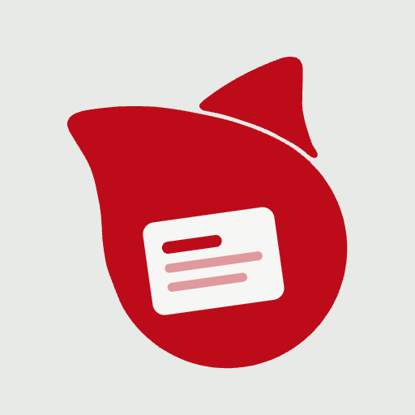

<p align="center"></p>

# Snippet Book (snippet-book)

[日本語](README.md) | **English**

[](https://github.com/eiwaupkaz-del/snippet-book/actions/workflows/verify.yml)

A small tool for storing text you use often — commands, notes, IDs and passwords — and copying it with a single click (or tap on a phone).

- Use it: **https://snippet.eiwa-up.jp/**
- Manual (Japanese): [docs/manual-V2.01.011.pdf](docs/manual-V2.01.011.pdf)
- Current version: **Version 2.01.011**

> **Note:** the app's screens and the manual are in Japanese only. This page explains what the app does and how it protects your data.

---

## Why this repository is public

Snippet Book holds things as important as passwords, so **anyone should be able to read and check what it does.**

- The app is a single HTML file ([`app/snippet-book.html`](app/snippet-book.html)) plus icons and a font. **It loads nothing from other sites** (since Version 2.00.003; earlier versions loaded the font from Google Fonts).
- Once an hour, GitHub automatically checks that the files served by the site and its security headers (CSP) are **the same as this repository** (the **verify** badge above — green means they match).

## How your data is protected (in short)

- Everything you register is stored **encrypted, only inside your browser** (localStorage). **There is no mechanism that sends your entries anywhere.**
- The page's Content Security Policy:
  - blocks network requests from scripts (`connect-src 'none'`),
  - loads images and fonts only from the same site (`default-src 'none'`, `font-src 'self'`),
  - allows exactly one script, pinned by its hash, so any injected script will not run (`script-src 'sha256-…'`).
  - A CSP does not block *every* kind of traffic (for example, following a link or navigating away), so we say "there is no mechanism that sends your entries out" rather than "no network traffic at all".
- Your data is encrypted with a random 256-bit key generated by the app. There is no master password to remember.
- That key is stored only in "wrapped" (encrypted) form, by two independent methods:
  - **Passkey** (fingerprint, face, device PIN): a wrapping key is derived from the WebAuthn PRF extension output.
  - **Recovery key** (25 characters, 125 random bits): for a new device or when a passkey is not available.
- Backup files contain only the wrapped keys. **A stolen backup cannot be read without a passkey or the recovery key.**
- Neither the passkey's PRF output nor the recovery key itself is ever stored.
- When you share a set with someone, the app generates a 20-character password (about 99 bits). A password you choose yourself for a file must be at least 12 characters.
- After a period of inactivity (5 minutes by default) the app locks itself. Copied passwords and recovery keys are cleared from the clipboard after 30 seconds (only while this page is in front; clipboard history tools cannot be cleared).
- When the app locks (manually or automatically), it first clears everything shown on the page, then finishes saving, then erases the key from memory. Unsaved edits that cannot be written in time (at most 5 + 2 seconds) are kept encrypted with the data key and offered back the next time you unlock. Any operation that was in progress when the lock happened is cancelled instead of continuing afterwards.
- The data and the key information are written together in one storage write, with an update counter, so they cannot get out of step and an older tab or an older save cannot overwrite newer data. Writes are serialized across tabs with Web Locks; browsers without Web Locks are treated as read-only.
- Backups carry a tamper-evident MAC (HMAC-SHA256 with a key derived from the data key) that also covers the passkey list, the list of removed passkeys and the history. Modified files are rejected. File names carry a 10-character tag derived from the file's SHA-256.
- Imported files are fully checked before anything is added (5 MB, 200 sets, 10,000 cards at most), and every value is treated as plain text.

For details, see [docs/how-it-works.en.md](docs/how-it-works.en.md) (Japanese: [docs/how-it-works.md](docs/how-it-works.md)).

## What it cannot protect against

- **If the served page itself is replaced** by an attacker, opening that page could expose your data. This is true of any web app.
  - The hourly check (verify) is for **noticing** such a change afterwards; it cannot stop you from opening a modified page.
  - Only the owner can update the site and this repository.
  - If you are worried, check the SHA-256 (below) before using it.
- If someone uses your device while it is unlocked, the app cannot protect you (please use your device's screen lock).

## Check that you have the genuine app (SHA-256)

| Version | SHA-256 (snippet-book.html) |
|---|---|
| Version 2.01.011 | `2ce3268191bbf8158f3dbf30c63c290fa35cb533e5511e8465127692ef9757e1` |
| Version 2.01.010 | `4946c2291a5c05dae61711e68cd433a6f5978af8a9c72be4cc1ec1efb3acd74d` |

Values for the other files (icons, fonts, etc.) are in [`app/SHA256SUMS`](app/SHA256SUMS).

On macOS (Terminal):

```bash
curl -s https://snippet.eiwa-up.jp/ | shasum -a 256
```

On Windows (PowerShell):

```powershell
Invoke-WebRequest https://snippet.eiwa-up.jp/ -OutFile snippet-book.html; Get-FileHash snippet-book.html -Algorithm SHA256
```

If the value matches the table, the app being served is the same as the one in this repository.

## Repository layout

| Path | Contents |
|---|---|
| `app/` | The exact files served by the site (HTML, icons, manifest, `fonts/`) and `SHA256SUMS` |
| `deploy/snippet.conf` | The site's nginx configuration (security headers and CSP). verify checks that the live site's CSP matches it |
| `tests/test-core.mjs` | Tests for the key handling (extracts the `/*<core>` … `/*</core>*/` part of the HTML and runs it) |
| `tests/test-v2111.mjs` | Tests for the generated password strength, loading nothing from other sites, the CSP hash matching the HTML, import checks, auto-lock and clipboard, clearing the screen on lock, cancelling work interrupted by a lock, single-write storage, multi-tab safety, passkey list merging, tamper-evident backups and more |
| `docs/` | Manual (PDF and source HTML, Japanese) and the technical description |
| `.github/workflows/verify.yml` | Tests and the hourly comparison with the live site |

## Running the tests

With Node.js 18 or later:

```bash
node tests/test-core.mjs
node tests/test-v2111.mjs
```

## Reporting problems

Please report ordinary bugs as Issues. **Security problems** (for example, data becoming readable) should not be posted publicly — please follow [SECURITY.md](SECURITY.md).

## License

The code is under the [MIT License](LICENSE). The app icon and the mark it is based on are not covered by the MIT License (see [LICENSE](LICENSE)). The IBM Plex Mono font (`app/fonts/`) is under the SIL Open Font License 1.1 ([app/fonts/OFL.txt](app/fonts/OFL.txt)).
