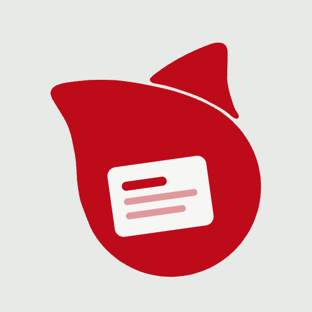

<p align="center"></p>

# スニペット帳（snippet-book）

[](https://github.com/eiwaupkaz-del/snippet-book/actions/workflows/verify.yml)

よく使う文章・コマンド・ID やパスワードを登録しておき、クリック（スマホはタップ）だけでコピーできる道具です。

- 使う：**https://snippet.eiwa-up.jp/**
- マニュアル：[docs/manual-V2.00.002.pdf](docs/manual-V2.00.002.pdf)
- 現行版：**Version 2.00.002**

> A small, single-file web app to store and copy text snippets and credentials. Everything stays in your browser, encrypted with a random key that is wrapped by a passkey (WebAuthn PRF) and by a recovery key. Nothing is sent to any server.

---

## このリポジトリを公開している理由

スニペット帳は、パスワードのような大切なものを預かる道具です。だから、**中身を誰でも読めて、確かめられる**ようにしています。

- アプリは HTML ファイル 1 枚（[`app/snippet-book.html`](app/snippet-book.html)）です。外から読み込むのは表示用の文字の形（Google Fonts）だけです。
- サイトで配っている中身が、このリポジトリと**同じかどうか**を、GitHub が毎日自動で確かめています（上の **verify** の印。緑なら一致）。

## 守り方のしくみ（かんたんに）

- 登録した内容は、あなたのブラウザの中（localStorage）だけに、暗号化して保存します。**サーバーには何も送りません。** ページの CSP で、外への通信をすべて止めています（`connect-src 'none'`）。
- 暗号の鍵は、アプリが作るでたらめな 256bit の鍵です。人が覚えるパスワードは使いません。
- その鍵を、次の 2 つで「包んで」保存します。
  - **パスキー**（指紋・顔など）：WebAuthn の PRF 拡張で取り出した値から包む鍵を作ります。
  - **復元キー**（25 文字・125bit のでたらめな文字）：新しい端末やパスキーが使えないときに使います。
- バックアップファイルにも、包んだ鍵だけが入ります。**バックアップを盗まれても、パスキーか復元キーが無ければ読めません。**
- パスキーの PRF の値と復元キーそのものは、どこにも保存しません。

くわしくは [docs/how-it-works.md](docs/how-it-works.md) を見てください。

## 本物か確かめる（SHA-256）

| 版 | SHA-256（snippet-book.html） |
|---|---|
| Version 2.00.002 | `0c6915592c57dbff7546e25b6a959136e37ec88d18e977cbc38fc7aa6dc2d38b` |

アイコンなどほかのファイルの値は [`app/SHA256SUMS`](app/SHA256SUMS) にあります。

Mac のターミナルで：

```bash
curl -s https://snippet.eiwa-up.jp/ | shasum -a 256
```

Windows の PowerShell で：

```powershell
Invoke-WebRequest https://snippet.eiwa-up.jp/ -OutFile snippet-book.html; Get-FileHash snippet-book.html -Algorithm SHA256
```

出てきた値が上の表と同じなら、いま配っているものは、このリポジトリのものと同じです。

## フォルダの中身

| 場所 | 中身 |
|---|---|
| `app/` | サイトで配っているファイルそのもの（HTML・アイコン・manifest）と `SHA256SUMS` |
| `tests/test-core.mjs` | 鍵のしくみのテスト（HTML の中の `/*<core>` 〜 `/*</core>*/` を切り出して試します） |
| `docs/` | マニュアル（PDF と元の HTML）・しくみの説明 |
| `.github/workflows/verify.yml` | テストと、サイトとの照らし合わせ（毎日） |

## テストを動かす

Node.js 18 以降で：

```bash
node tests/test-core.mjs
```

## 問題を見つけたら

ふつうの不具合は Issue で知らせてください。**守りに関わる問題**（データが読めてしまうなど）は、公開の Issue には書かず、[SECURITY.md](SECURITY.md) の方法で知らせてください。

## ライセンス

プログラムは [MIT License](LICENSE) です。アプリのアイコンと、その元になったマークは MIT の対象外です（[LICENSE](LICENSE) を見てください）。
